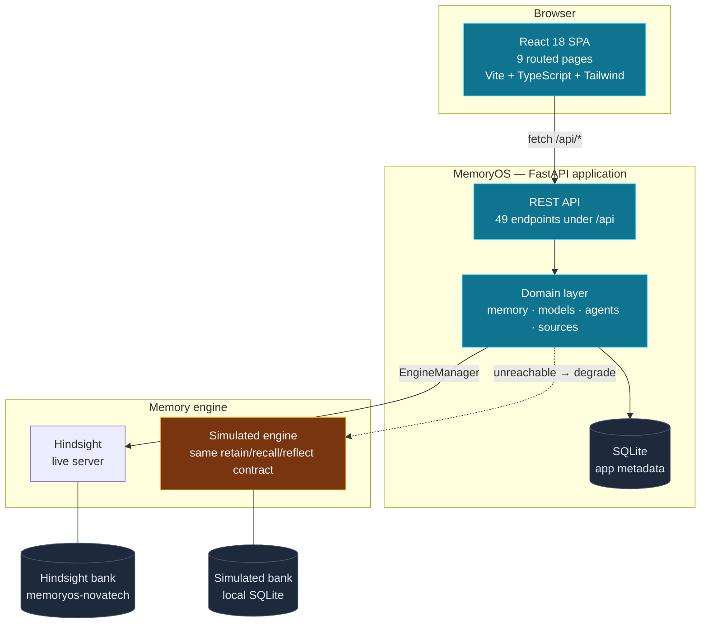
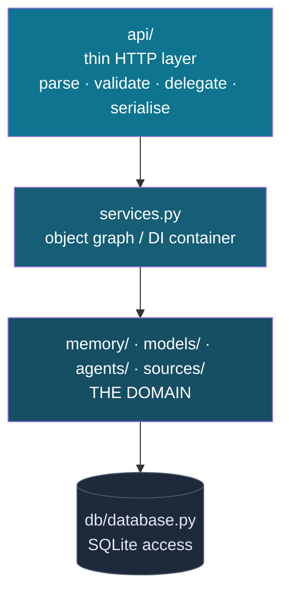
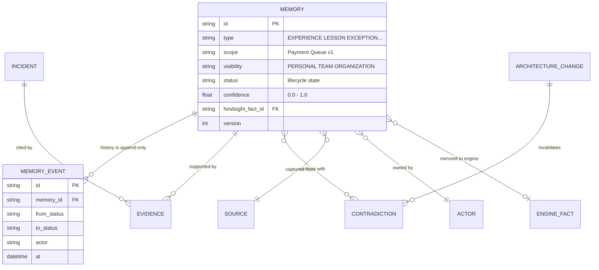
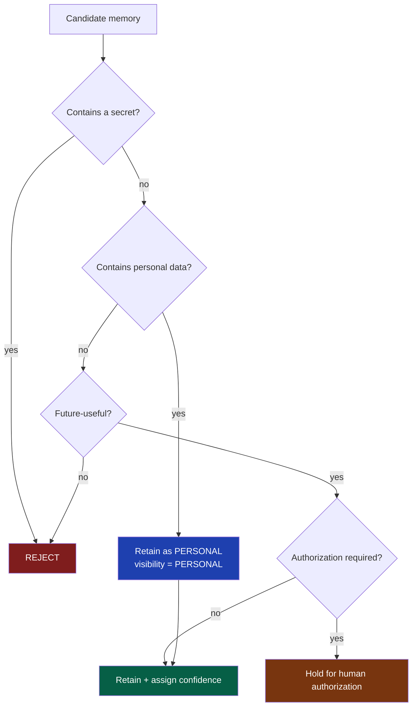
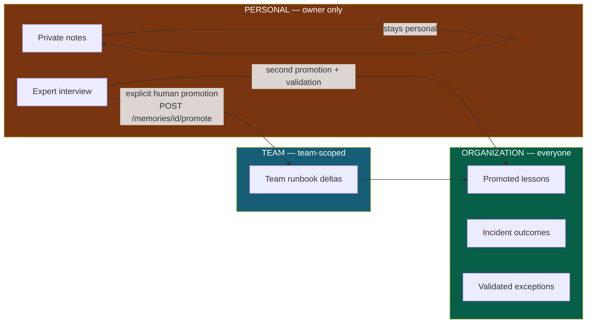
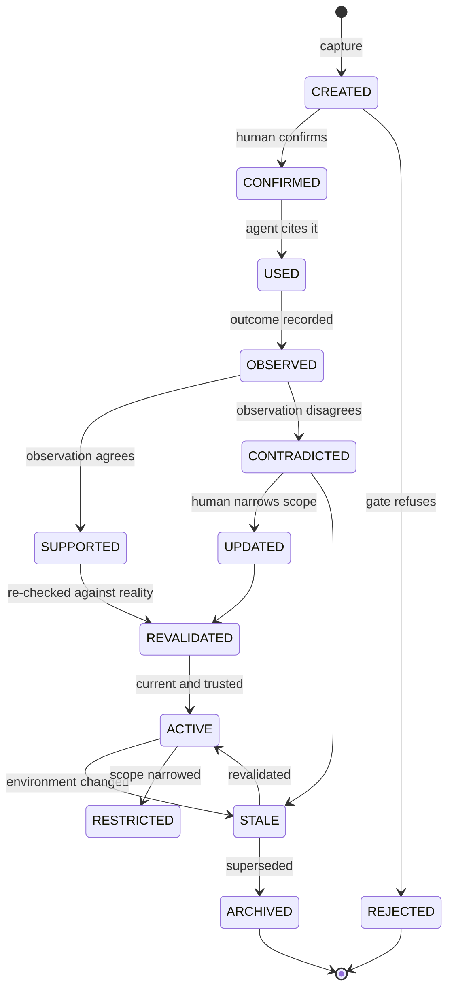
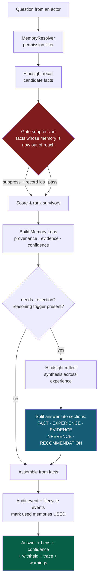
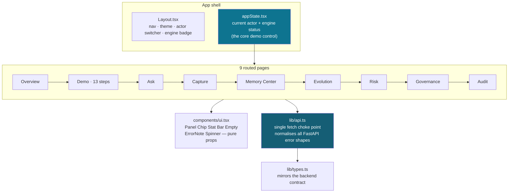
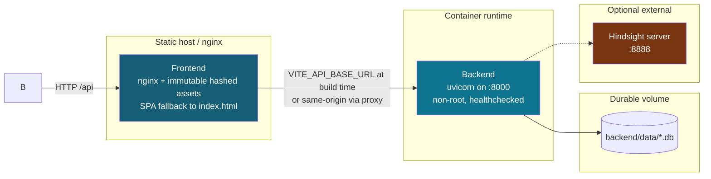

# MemoryOS — System Architecture

How the system is put together and why. For runtime step-by-step behaviour see
[`FLOWCHART.md`](FLOWCHART.md); for what each screen does see
[`../README.md`](../README.md).

> **All data in this project is synthetic.** Every person, system, incident and
> measurement is fictional and exists only to make the behaviour demonstrable.

---

## 1. The problem this architecture solves

An engineering organization accumulates experience that lives in people's heads.
When someone leaves, that experience leaves with them. The next engineer
re-encounters the same failure, reads a runbook that was written once and never
corrected, and asks a colleague or an assistant that has no organizational
memory at all.

MemoryOS stores what the organization *learned by doing things*, and — this is
the part that matters — makes every answer show its evidence, its scope, its
confidence and its origin. The architecture exists to enforce three properties:

| Property | Enforcement |
|---|---|
| **A private memory is never leaked through an organizational question.** | `MemoryResolver` filters before retrieval; the engine layer suppresses facts that lose their owning memory. Defence in depth, not one check. |
| **No answer is presented without provenance.** | The Memory Lens is assembled from real recalled facts, real evidence links and a real confidence computation. It is not optional decoration. |
| **Knowledge is never silently destroyed by change.** | Lifecycle history is append-only; contradictions are raised for a human, never auto-resolved. |

---

## 2. System context

**The engine abstraction is the load-bearing design decision.**
`backend/memory/hindsight_client.py` is the *only* module that talks to the
memory engine. It exposes one interface with two implementations:

- `HindsightEngine` — the real engine, calls `aretain` / `arecall` / `areflect`.
- `SimulatedHindsightEngine` — a dependency-free stand-in implementing the
  identical contract.

`EngineManager` probes the live engine at startup and after failures. If it
cannot be reached it degrades to the simulated engine **and records the
reason**. The UI renders the degraded state as `HINDSIGHT (SIMULATED)`, and
every answer produced that way carries an explicit simulated warning
(`backend/agents/successor_agent.py:130`).

This is why the whole product is demonstrable on a laptop with no Docker and no
API key — while never pretending simulated output is real engine output.

---

## 3. Layering

Dependencies point strictly downward. `api/` never imports from `db/` directly;
it goes through services.

| Layer | Package | Responsibility | May import |
|---|---|---|---|
| HTTP | `backend/api/` | Parse requests, validate, delegate, serialise. **No business logic.** | services, models, domain |
| Wiring | `backend/services.py` | Builds and caches the object graph. Single place dependencies are resolved. | everything |
| Domain | `backend/memory/`, `models/`, `agents/`, `sources/` | All business rules. | models, db, engine |
| Persistence | `backend/db/database.py` | SQL only. No business rules. | models |

`api/` files are intentionally thin. If a rule ends up in a route handler it
belongs in `memory/` — this is what lets the test suite exercise domain
behaviour without HTTP.

---

## 4. Two stores, deliberately split

| Store | File | Holds | Why separate |
|---|---|---|---|
| Application DB | `backend/data/memoryos.db` | Memories, lifecycle events, evidence, contradictions, audit trail, actors, incidents, architecture changes | Governance metadata the product owns. Queryable, transactional, replaceable. |
| Engine bank | Hindsight server, or `backend/data/hindsight_sim.db` | Retained experience as engine facts | Owned by the memory engine. MemoryOS must be able to swap engines without migrating its own governance data. |

The consequence that matters: the engine can be replaced, degraded, or switched
off entirely and **governance still works**. Audit trail, permissions and
lifecycle never depend on the engine being reachable.

---

## 5. Domain model

Two axes carry the governance weight:

- **`visibility`** — `PERSONAL` → `TEAM` → `ORGANIZATION`. The permission
  boundary is enforced on this axis.
- **`status`** — the lifecycle state machine below. Enforced on the other.

---

## 6. The Memory Gate

Ingestion is not "store whatever arrives". Every candidate memory passes a gate
that decides *whether it should be retained at all*:

The gate's decisions are returned to the caller and shown in the UI. A
rejected capture tells you *why* it was rejected rather than failing silently.

---

## 7. Permissions and promotion

Knowledge is **never promoted automatically**. Personal experience becomes
organizational knowledge only through an explicit, audited human action.

`MemoryResolver` decides what a given actor can reach. The UI surfaces
withheld memories explicitly rather than hiding them — you can see that
something was excluded and why, which is the honest behaviour for a system
making claims about what it knows.

---

## 8. Knowledge lifecycle

`backend/memory/lifecycle.py`. History is append-only; nothing is deleted.

Illegal transitions raise `InvalidTransition` (`strict=True`) rather than
silently corrupting state. The one deliberate exception is the agent marking a
memory `USED` after citing it, which passes `strict=False` because a citation
should never fail because a memory was mid-transition.

---

## 9. The ask pipeline — the central interaction

This is the flow the whole product is built around.

Two details are the difference between this and a chatbot:

1. **Suppression is recorded, not silent.** Fact IDs that were dropped are
   returned as `suppressed_fact_ids`. The UI shows a "Memory Gate suppressed N
   facts" counter. A privacy boundary you cannot audit is not a boundary.
2. **`reflect` is gated.** Trivial lookups never pay for synthesis
   (`REASONING_TRIGGERS`, `backend/memory/reflection.py:34`). The answer records
   `reflect_mode` so you can see whether it reasoned or merely retrieved.

---

## 10. Frontend architecture

Deliberately dependency-light: no Redux, no data-fetching library, no component
framework. React Context plus one 65-line `fetch` wrapper.

Notable choices:

- **One `fetch` in the entire codebase.** Every request goes through
  `lib/api.ts`, which normalises all four FastAPI `detail` error shapes into one
  `ApiError`. Adding a second network path would mean adding error handling
  twice.
- **The actor is the demo's central control.** Switching identity in the header
  changes what the permission resolver returns. It is rendered three times in
  the shell because it is genuinely the primary control.
- **`format.ts` owns all colour decisions.** No component hard-codes a Tailwind
  colour triple, which is what lets the dual-theme system work.
- **Degrade, don't break.** If the API is down the shell stays navigable
  (`appState.tsx`) rather than white-screening.

---

## 11. Technology choices and why

| Choice | Alternative | Reason |
|---|---|---|
| FastAPI + Pydantic v2 | Django / Flask | Pydantic models double as the API schema and the frontend contract source. Validation and serialisation in one definition. |
| SQLite | Postgres | Zero-setup for a demo. The access pattern is small, indexed, single-writer. Postgres is the drop-in upgrade — `db/database.py` is the only file that changes. |
| `hindsight-client` | Roll retrieval by hand | Proven memory engine with a real retain/recall/reflect contract, plus a bank concept that fits "organizational memory" directly. |
| Engine abstraction with simulated fallback | Hard-require the engine | Product stays demonstrable offline while never misrepresenting simulated output as real. |
| React Context, no Redux | Redux / Zustand / TanStack Query | State is one actor + one engine status object. A store library would be more machinery than state. |
| Tailwind + CSS-variable theme | CSS modules / styled-components | One inverted `slate` ramp lets every existing class name survive a theme change untouched. Zero hard-coded colours in components. |
| Vitest-less, Playwright-less (removed) | Test runner installed | `playwright` and `recharts` were declared but never used. Unused dependencies are liability, not capability. |

---

## 12. Deployment topology

The app is container-ready and has no cloud dependency.

`frontend/nginx.conf` carries the `try_files … /index.html` fallback, without
which every deep link and page refresh 404s under `BrowserRouter`.

See [`RUNNING.md`](RUNNING.md) for local, Docker and production commands.

---

## 13. What is deliberately absent

Naming these is part of the architecture, because each was a decision:

- **No authentication.** Actors are selected, not logged in. There is a real
  permission model; there is no identity provider behind it.
- **No multi-tenancy.** One bank, one organisation.
- **No write path from the frontend other than POST actions.** No `PUT`/`PATCH`
  /`DELETE` exists in the API client — the product is read-and-act, not CRUD.
- **No external LLM call by default.** `llm_provider` defaults to `none` and is
  never read by the engine path. See [`PROMPT_CONFIGS.md`](PROMPT_CONFIGS.md) for
  what that means for the prompt configuration surface.
- **No code splitting.** All 9 pages are eagerly imported into one 245 kB
  bundle. Fine at this size; the first thing to change at scale.

---

## 14. Where to look next

| Question | File |
|---|---|
| How does a request actually flow? | [`FLOWCHART.md`](FLOWCHART.md) |
| What prompts exist and where? | [`PROMPT_CONFIGS.md`](PROMPT_CONFIGS.md) |
| How do I run this? | [`RUNNING.md`](RUNNING.md) |
| What does each screen show? | [`../README.md`](../README.md) |
| What was built and what is still open? | [`../session.md`](../session.md) |
