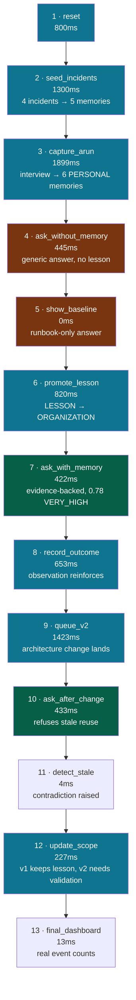
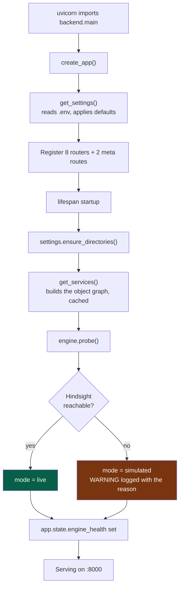
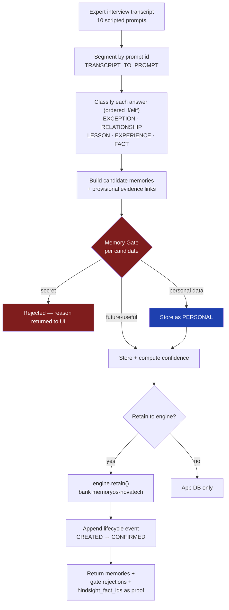
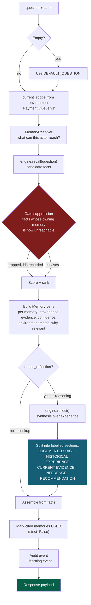
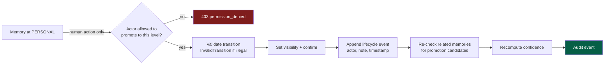
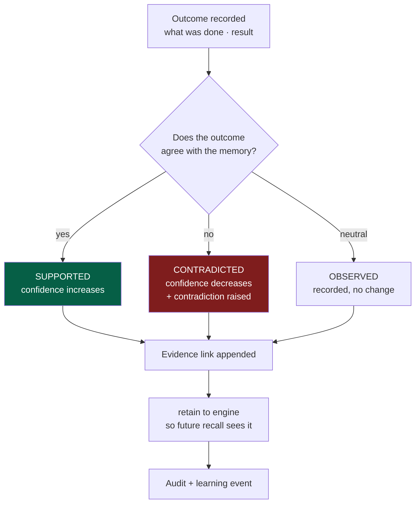
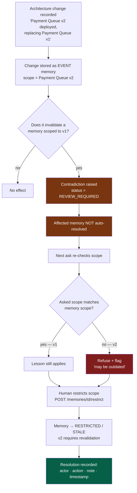
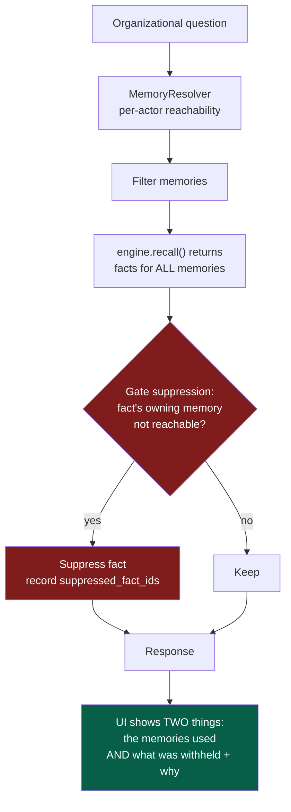
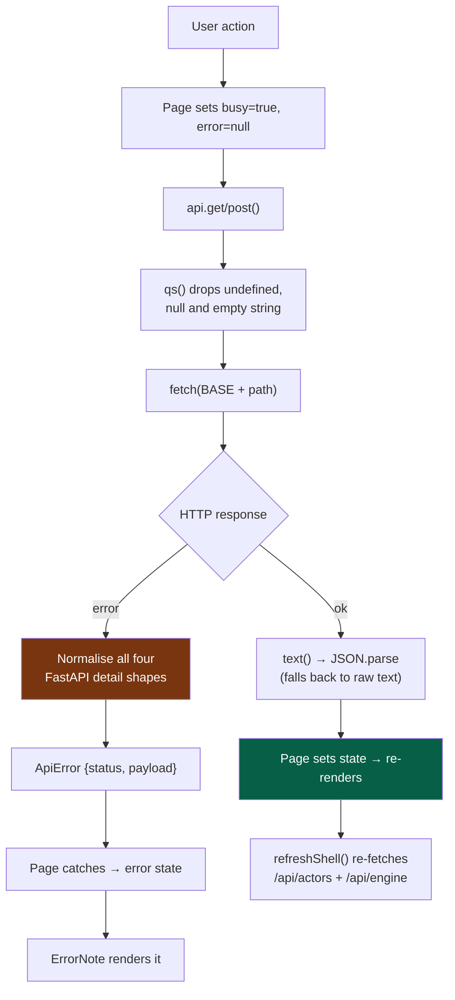
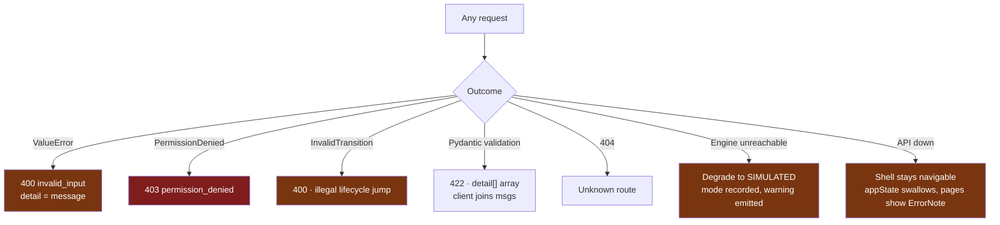

# MemoryOS — Runtime Flowcharts

What actually happens, step by step, at runtime. Companion to
[`ARCHITECTURE.md`](ARCHITECTURE.md) (structure) and
[`RUNNING.md`](RUNNING.md) (commands).

Every timing and step name below was captured from a real `POST /api/demo/run`
against the running application, not written from the source.

> Seeded scenario used throughout: company `NovaTech`, bank `memoryos-novatech`,
> running component `Payment Queue v1`, default actor `maya` (New DevOps
> Engineer).

---

## 1. The 13-step demo at a glance

One call — `POST /api/demo/run` — executes the whole product story. Verified
run: **status `ok`, 100%, 8,210 ms total**, all 13 steps `ok`.



Steps 4–5 are deliberately the *weak* answer. Without them, step 7 has nothing
to be an improvement against.

---

## 2. Startup



Degradation is the expected path, not an error path. Probe it any time:

```bash
curl -s http://127.0.0.1:8001/api/engine
```

---

## 3. Flow — Capture experience

`POST /api/capture` · the expert interview ingestion path.



**Verified behaviour** (demo step 3): one interview produces six memories —
`EXPERIENCE`, `LESSON`, `EXCEPTION`, `RELATIONSHIP` and `FACT` types — **all at
`visibility: PERSONAL`, `status: CREATED`**. They stay personal because the
system does not promote knowledge on its own.

---

## 4. Flow — Ask (the central interaction)

`POST /api/ask` · `SuccessorAgent.ask()`.



### `needs_reflection` — when synthesis is skipped

15 triggers (`backend/memory/reflection.py:34`), plus a 12-character minimum.
Verified:

| Question | Reflects? | Why |
|---|---|---|
| `Payment API is showing connection reset alerts. What should I do?` | **yes** | `what should i` |
| `Tell me about the outage` | **yes** | `tell me` |
| `Explain the queue` | **yes** | `explain` |
| `Who owns payments?` | no | no trigger |
| `What is the retry limit?` | no | no trigger |
| `what is 2+2` | no | under 12 chars |

### What the answer looks like — before vs. after promotion

**Step 4 (before the lesson exists)** — generic, no organizational evidence:

> reflect_mode `simulated` · 5 memories · 10 facts, 0 suppressed · confidence
> **0.788 / VERY_HIGH** · `outdated: true`

**Step 7 (after promotion)** — the headline inverts the runbook:

> *"Follow the recorded organizational experience before the documented
> runbook."*
>
> `DOCUMENTED FACT` — Payment API depends on Payment Queue v1; connection-reset
> alerts are frequently caused by the queue rather than the API process.
> `HISTORICAL EXPERIENCE` — INC-1042, INC-1088 … each with the action taken and
> its measured result.

**Step 10 (after the architecture change)** — refuses to reuse stale knowledge:

> *"Do NOT reuse the historical procedure — it may be outdated."*

That refusal is the entire thesis of the product, and it is produced by the
scope check rather than by a prompt instruction.

---

## 5. Flow — Explicit promotion

`POST /api/memories/{id}/promote` · nothing is promoted automatically.



Verified (step 6): `LESSON` *"Check queue depth before restarting the Payment
API"* moves `PERSONAL → ORGANIZATION`, lands on `status: ACTIVE`, confidence
**0.7545**, and keeps its 3 evidence links.

---

## 6. Flow — Outcome learning

`POST /api/outcome` · a real observation strengthens or weakens memory.



---

## 7. Flow — Architecture change → contradiction → resolution

This is the resilience path. Change invalidates knowledge; the system surfaces
that instead of silently applying stale advice.



Governance drives resolution from the server, not the client
(`GET /api/governance/summary` returns `resolution_actions`; the UI renders
exactly those buttons).

---

## 8. Flow — Privacy boundary

The demo's central claim: **personal memory is never returned through an
organizational question.**



Two independent checks — resolver filters before recall, suppression filters
after. If either were removed the boundary could still leak.

The `withheld` array is returned rather than hidden, and
`successor_agent.py:141` emits an explicit warning. A privacy boundary you
cannot audit is not a boundary.

Verified actors and their visibility ceilings:

| Actor | Role | Ceiling |
|---|---|---|
| `arun` | Senior DevOps Engineer | ORGANIZATION |
| `maya` | New DevOps Engineer | ORGANIZATION |
| `priya` | Staff Identity Engineer | ORGANIZATION |
| `ravi` | Network Reliability Engineer | ORGANIZATION |
| `steward` | Knowledge Steward | ORGANIZATION |
| `outsider` | Contractor | **PERSONAL** |
| `system` | System | ORGANIZATION |

Switch to `outsider` in the header to watch the answer contract.

---

## 9. Flow — Frontend request lifecycle



`refreshShell()` re-runs after every mutation so the actor list and engine
badge never drift from server state.

---

## 10. Error paths



Every one of these is visible in the UI. The app never fails silently.

---

## 11. Verification flows

The commands to prove each claim above.

```bash
# Engine mode + bank config
curl -s http://127.0.0.1:8001/api/engine

# Full 13-step story — expect status "ok", 13 steps, progress_percent 100
curl -s -X POST http://127.0.0.1:8001/api/demo/run \
     -H "Content-Type: application/json" -d '{}'

# Permission boundary — compare visibility counts per actor
curl -s "http://127.0.0.1:8001/api/memories?actor=maya&limit=200"
curl -s "http://127.0.0.1:8001/api/memories?actor=outsider&limit=200"

# Withheld + suppression counters on a single ask
curl -s -X POST http://127.0.0.1:8001/api/ask \
     -H "Content-Type: application/json" \
     -d '{"question":"Payment API is showing connection reset alerts. What should I do?","actor":"outsider"}'

# Backend suite — expect 37 passed
.venv/Scripts/python.exe -m pytest backend/tests -q

# Frontend — expect clean exits
cd frontend && npm run lint && npm run typecheck && npm run build
```

---

## 12. Reading the traces

Every ask response carries its own execution trace, which is why the demo can
be audited rather than just watched:

```json
{
  "trace": {
    "steps": ["permission filter", "recall", "gate suppression", "lens", "reflect"],
    "recall":      { "operation": "recall", "simulated": true, "candidates_scored": 10 },
    "reflect":     [ /* per-step reflection trace */ ],
    "latency_ms":  422,
    "reflect_mode": "simulated",
    "engine_mode": "simulated",
    "engine_simulated": true,
    "fact_ids":            ["fact-…"],
    "suppressed_fact_ids": []
  }
}
```

The Ask page renders this directly, which is how a reviewer can confirm the
privacy boundary actually ran rather than taking the claim on trust.
