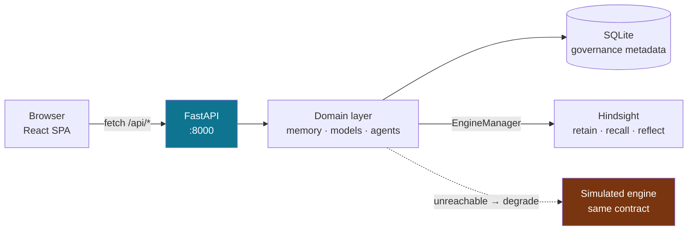

# MemoryOS — Submission Checklist

Evidence for each required checklist item, and — more usefully — an explicit
account of what is **not** yet true. Read §4 before submitting.

Repository: <https://github.com/Nanakjoth/experience-memory>
License: MIT

---

## 1. Theme alignment — **Resilience**

MemoryOS is an organizational resilience system. The theme is not decoration; it
is what the code enforces.

| Resilience property | Implementation | Proof |
|---|---|---|
| **Institutional knowledge survives personnel loss** | Memories are stored with provenance, scope, confidence and evidence — not in a person's head | The `Risk` page computes bus factor: `knowledge_items`, `personal_only`, `replacement_coverage`, `successor_ready` |
| **The organization does not repeat known failures** | An expert's lesson is promoted to `ORGANIZATION` and cited with its originating incident | Demo steps 3→6→7: capture, promote, then a *different* answer backed by `INC-1042` |
| **The system degrades rather than fails** | Engine abstraction with a simulated fallback implementing the identical `retain`/`recall`/`reflect` contract | App runs with Hindsight down; `GET /api/engine` reports `mode: simulated` with the reason |
| **Stale knowledge is refused, not applied** | Scope checks and contradiction detection | Demo step 10: *"Do NOT reuse the historical procedure — it may be outdated."* |
| **Every action is recoverable and attributable** | Append-only lifecycle history + audit log | `/audit`; `GET /api/memories/{id}/history` |

**Why not the other tracks:**

- *Innovation* — arguable, but the interesting part is not novelty; it is
  governance discipline applied to retrieval.
- *Sustainability* — no environmental dimension.
- *Cooperation* — multi-user by construction, but that is a property of the
  data model rather than the thesis.

**The one-line pitch:** an organization that can explain *why* it knows
something, and refuses to act on that knowledge once it has been invalidated.

---

## 2. Code repository

<https://github.com/Nanakjoth/experience-memory>

### App logic

| Area | Location | Size |
|---|---|---|
| Domain layer | `backend/memory/` | 10 modules — engine, retrieval, reflection, confidence, governance, lifecycle, provenance, contradiction, ingestion |
| HTTP API | `backend/api/` | 8 routers, **49 routes** |
| Successor agent | `backend/agents/successor_agent.py` | The ask pipeline end to end |
| Data model | `backend/models/` | Pydantic v2 — the API contract |
| Persistence | `backend/db/database.py` | 12 tables, SQLite |
| Scenario | `backend/seed/novatech.py` | The synthetic NovaTech dataset |
| Frontend | `frontend/src/` | 20 files, 9 pages, ~3,800 lines |

~12,100 lines of Python, ~3,800 lines of TypeScript/TSX.

### Prompt configs

Documented in full at **[`PROMPT_CONFIGS.md`](PROMPT_CONFIGS.md)**:

| Config | Location |
|---|---|
| Bank mission | `backend/memory/hindsight_client.py:43` |
| 8 bank directives | `backend/memory/hindsight_client.py:51` |
| Bank disposition | `backend/memory/hindsight_client.py:63` |
| 10 capture prompts | `backend/sources/expert_interview.py:17` |
| 15 reasoning triggers | `backend/memory/reflection.py:34` |
| Confidence disclaimer | `backend/memory/confidence.py:45` |
| Engine budgets | `.env` → `backend/config.py:70` |

Each directive is mapped to the specific behaviour it produces, so the prompts
can be audited rather than admired.

### Running instructions

**[`RUNNING.md`](RUNNING.md)** — prerequisites, quick start, configuration
reference, Docker, production build, SPA-fallback requirements, CI, and a
troubleshooting table.

Shortest path for a reviewer:

```bash
python -m venv .venv && .venv/bin/pip install -r requirements.txt
.venv/bin/uvicorn backend.main:app --port 8000     # terminal 1

cd frontend && npm install && npm run dev          # terminal 2
```

Then <http://localhost:5173/demo> → **Run full demo**. No API key, no Docker, no
cloud account.

### Verification status

| Check | Command | Result |
|---|---|---|
| Backend tests | `pytest backend/tests -q` | **37 passed** |
| Full demo | `POST /api/demo/run` | **status `ok`, 13/13 steps, 100%** |
| TypeScript | `npm run typecheck` | clean |
| Lint | `npm run lint` | clean |
| Build | `npm run build` | 245 kB / 72 kB gzip |
| CI | `.github/workflows/ci.yml` | tests + typecheck + lint + build + secret guard |

---

## 3. Architecture overview

Full detail with diagrams: **[`ARCHITECTURE.md`](ARCHITECTURE.md)**
Step-by-step runtime: **[`FLOWCHART.md`](FLOWCHART.md)**

### As built



Three points worth stating plainly:

1. **The engine abstraction is the design.** `backend/memory/hindsight_client.py`
   is the only module that talks to the memory engine. Two implementations, one
   interface. The app is fully exercisable offline and never presents simulated
   output as real — degraded mode is labelled in the header and every affected
   answer carries an explicit warning.

2. **Two stores, deliberately split.** Application metadata (memories, audit,
   lifecycle) lives in SQLite and is owned by the product. Engine content lives
   in the Hindsight bank. Governance therefore keeps working even when the engine
   is down.

3. **Privacy is enforced in code, not by prompt.** `MemoryResolver` filters
   before recall; the engine layer suppresses facts whose owning memory is now
   unreachable. Two independent checks. Withheld memories are returned and
   displayed rather than silently dropped, so the boundary is auditable.

### Deployment

Container-ready, no cloud dependency:

- `backend/Dockerfile` — non-root, healthchecked, SQLite on a volume
- `frontend/Dockerfile` — nginx, immutable hashed assets, SPA fallback
- `docker-compose.hindsight.yml` — optional live engine

---

## 4. Gaps — read this before submitting

Stated plainly, because a checklist answered with a false claim is worse than a
checklist answered with a gap.

### 4.1 There is no Google Cloud or Gemini integration

**Checklist item 3 asks for an explanation of Google Cloud + Gemini integration.
This project has none.** A repository-wide search across `backend/` and
`frontend/src/` for `gemini`, `google.generativeai`, `genai`, `vertex`,
`firebase` and `cloud run` returns zero matches. `google-genai` is not a
dependency. There is no Firebase config. There is no Cloud Run or GKE
deployment.

Specifically:

- `LLM_PROVIDER` (`backend/config.py:65`) defaults to `"none"` and is **never
  read by any execution path**.
- **No external LLM is called at any point.** Answer text is composed
  deterministically from recalled facts by `ReflectionService`, not generated by
  a language model.
- `llm_model`'s default of `gpt-4o-mini` is a placeholder predating any
  integration and is not a statement about the stack.
- The `HINDSIGHT (SIMULATED)` label refers to the **memory engine**, not to a
  language model.

What exists instead is deployment-ready containerisation (`Dockerfile` × 2,
healthchecks, non-root, a durable volume) which is the substrate a Cloud Run
deployment would use — but that is not a Google Cloud deployment, and it should
not be described as one.

**If item 3 is mandatory, this submission does not currently satisfy it.** The
integration is not a large piece of work — `ReflectionService.reflect()` is the
honest seam, and the engine abstraction already isolates the memory layer from
the answer layer — but it has not been built.

### 4.2 Frontend has no automated tests

The backend has 37 tests. The frontend has none. `playwright` was declared as a
devDependency but had no config, no runner and no spec files; it has been
removed rather than left as an unused liability. The frontend gates on strict
TypeScript, ESLint and a production build, but a human clicking through the
pages is currently the only functional check.

### 4.3 Known code smells, deliberately not fixed

Repo hygiene was the agreed scope; these are real but non-blocking:

| Issue | Location |
|---|---|
| Confidence-band thresholds duplicated | `format.ts:48` (`bandFor`, unused) vs `MemoryCenter.tsx:218` (`bandOf`, live) |
| "Provenance" block rendered twice | `MemoryCenter.tsx:285` and `:332` — looks like a merge artifact |
| 26 of 40 exported types unused | `frontend/src/lib/types.ts` |
| 4 unused formatters | `bandFor`, `timeOnly`, `titleCase`, `sentence` |
| Dead `@/*` path alias | `tsconfig.json:19` has no matching Vite `resolve.alias` |
| No error boundary | An uncaught render exception blanks the app |
| No code splitting | All 9 pages in one 245 kB bundle |
| `teal` not theme-mapped | `Demo.tsx:38` — the one tone that doesn't flip with the theme |

### 4.4 Git history

Four commits with non-descriptive messages (`strated`, `done somthing`, …).
The working tree is clean but the history does not read as professional. Worth
squashing into a coherent series before submission if presentation matters.

---

## 5. What genuinely holds up

In a checklist of partials, it is worth being explicit about the parts that are
strong, because they are the parts that are hard:

- **37 backend tests pass**, covering the API, permissions, lifecycle
  transitions and the full demo.
- **The 13-step demo runs green end to end** — verified `status: ok`, 13/13,
  100%, ~8.2s.
- **Every governance claim is machine-checkable.** `suppressed_fact_ids`,
  `withheld[]`, `trace.steps`, `reflect_mode`, per-memory `lifecycle.actions`
  with illegal transitions marked — a reviewer can verify the privacy boundary
  and the staleness refusal rather than taking them on trust.
- **The product refuses the wrong answer.** Demo step 10 declining to reuse a
  historical procedure after an architecture change is the thesis of the whole
  system, and it comes from a scope check rather than a prompt instruction.
- **It runs anywhere with no accounts.** Two commands, no Docker, no API keys.
- **Honest degradation.** Nothing in the UI pretends to be something it is not.

---

## 6. Suggested submission narrative

> **MemoryOS** is an operational memory layer for engineering organizations,
> aimed at institutional resilience: the knowledge that leaves when people leave,
> and the discipline to stop trusting that knowledge once it has been invalidated.
>
> The differentiator is not retrieval. It is that every answer shows its
> evidence, states its scope, carries a computed confidence, and — when the
> environment has moved on — refuses to answer at all.
>
> We built it as a closed loop: capture expert experience privately, promote it
> only by explicit human decision, cite it with its originating incident, and
> detect when an architecture change has quietly invalidated it.
>
> It runs end to end with no API keys, no Docker and no cloud account, and every
> governance claim it makes is verifiable from the response payloads.
